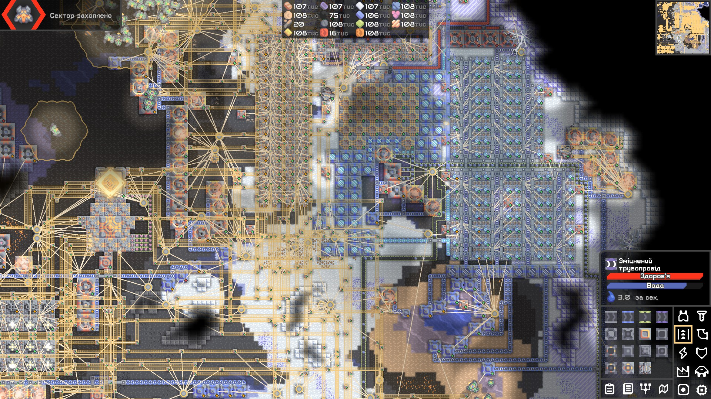
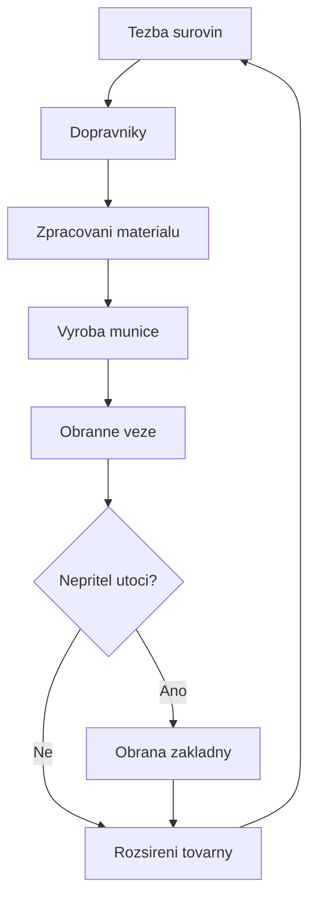

# Mindustry – Průvodce přežitím a recenze hry

Vítejte v mém projektu věnovaném hře **Mindustry**.

Mindustry je strategická hra, která kombinuje **Tower Defense, automatizaci továren, budování základen a real-time strategii**. Hráč musí získávat suroviny, stavět výrobní linky a bránit svou základnu před nepřátelskými útoky.

*Na první pohled může hra vypadat jednoduše, ale vytvoření efektivní továrny vyžaduje dobré plánování a logické myšlení.*

> **Hlavní pravidlo:** Bez surovin není výroba. Bez výroby není munice. A bez munice dlouho nepřežijete.

---

## 1. Základní informace o hře

| Vlastnost | Informace |
|---|---|
| Název | Mindustry |
| Vývojář | Anuken |
| Žánr | Tower Defense / RTS / Sandbox |
| Herní režimy | Singleplayer, Multiplayer |
| Platformy | Windows, Linux, macOS, Android |
| Hlavní cíl | Vybudovat a ubránit základnu |
| Moje hodnocení | 9/10 |

### Jak hra funguje?

Ve hře Mindustry začínáte s malou základnou a postupně budujete rozsáhlou průmyslovou síť.

Vaším hlavním úkolem je:

1. Těžit základní suroviny.
2. Přepravovat materiály pomocí dopravníků.
3. Vyrábět pokročilé materiály a energii.
4. Stavět obranné věže a jednotky.
5. Bránit základnu před nepřátelskými útoky.
6. Rozšiřovat svou základnu a dobývat další sektory.

**Nejdůležitější je správné plánování.** Pokud máte špatně postavené dopravníky, může se zastavit celá výroba.

---

## 2. Těžba a automatizace

### Základní suroviny

Mezi nejdůležitější suroviny ve hře patří:

- **Copper (měď)** – základní stavební materiál.
- **Lead (olovo)** – používá se při výrobě a stavbě.
- **Coal (uhlí)** – důležitý zdroj pro výrobu a energetiku.
- **Titanium (titan)** – pokročilý materiál pro moderní technologie.
- **Silicon (křemík)** – nezbytný pro výrobu jednotek a pokročilých zařízení.
- **Thorium (thorium)** – důležitý materiál pro pokročilé technologie.

### Automatizace výroby

Jednou z nejzajímavějších částí hry je možnost vytvářet automatické výrobní systémy.

Například:

**Vrták → Dopravník → Továrna → Výsledný produkt**

Správně vytvořený systém dokáže pracovat bez neustálého zásahu hráče.

*Moje doporučení: Vždy nechte kolem výrobních linek dostatek prostoru pro budoucí rozšíření.*

---

## 3. Obrana základny

Obrana je jednou z nejdůležitějších součástí hry Mindustry.

### Typy obranných věží

| Věž | Výhody | Nevýhody |
|---|---|---|
| Duo | Levná a jednoduchá | Slabší proti silným nepřátelům |
| Scatter | Dobrá proti létajícím jednotkám | Neútočí na pozemní cíle |
| Hail | Velký dostřel | Potřebuje správnou munici |
| Lancer | Silný elektrický útok | Potřebuje energii |
| Meltdown | Velmi vysoké poškození | Vysoká spotřeba energie a kapaliny |

### Moje strategie obrany

Při stavbě základny používám několik pravidel:

1. Nejdříve postavím základní obranné věže.
2. Zajistím pravidelnou dodávku munice.
3. Posílím hlavní směr nepřátelských útoků.
4. Přidám silnější věže a opravovací zařízení.
5. Připravím záložní zdroj energie.

**Důležité:** Silné věže bez munice nebo energie jsou prakticky nepoužitelné.

~~Stačí postavit jednu věž a celá základna bude v bezpečí.~~

---

## 4. Ukázka hry

Na následujícím obrázku je ukázka hry Mindustry.



*Obrázek ukazuje prostředí hry Mindustry, ve kterém hráč buduje továrny, přepravuje suroviny a organizuje obranu své základny.*

---

## 5. Můj seznam úkolů

Tento seznam představuje můj plán pro úspěšný rozvoj základny.

- [x] Vytvořit základní továrnu.
- [x] Zautomatizovat těžbu mědi a olova.
- [x] Postavit první obranné věže.
- [x] Zajistit výrobu elektrické energie.
- [ ] Vytvořit efektivní výrobu titanu a křemíku.
- [ ] Postavit pokročilou obrannou linii.
- [ ] Dobýt všechny sektory na planetě Serpulo.
- [ ] Dokončit kampaň na planetě Erekir.

*Dokončení všech těchto úkolů vyžaduje čas, trpělivost a dobrou strategii.*

---

## 6. Programování a logika

Mindustry je zajímavá také tím, že podporuje logické řízení některých herních zařízení pomocí procesorů.

Pro jednoduchou ukázku automatizace jsem vytvořil následující program v jazyce Python.

### Ukázka kódu v Pythonu

```python
# Jednoducha simulace vyroby v Mindustry

copper = 100
lead = 80

def check_resources(copper, lead):
    if copper >= 50 and lead >= 40:
        return "Dostatek surovin pro stavbu."
    else:
        return "Nedostatek surovin!"

print("Kontrola skladu:")
print(check_resources(copper, lead))
```

Tento program kontroluje, zda má hráč dostatek mědi a olova pro plánovanou stavbu.

**Výsledek programu:**

```text
Kontrola skladu:
Dostatek surovin pro stavbu.
```

*Jde pouze o jednoduchou simulaci v Pythonu, nikoliv o skutečný herní skript Mindustry.*

---

## 7. Matematika ve výrobě

Při plánování továren je užitečné počítat efektivitu výroby.

### Výpočet efektivity

Efektivitu výrobního systému můžeme zjednodušeně vyjádřit vzorcem:

```math
E = \frac{P}{M} \times 100
```

Kde:

- **E** – efektivita výroby v procentech.
- **P** – skutečný počet vyrobených jednotek za minutu.
- **M** – maximální možný počet jednotek za minutu.

Například pokud továrna vyrobí 80 jednotek za minutu, ale její maximální kapacita je 100 jednotek, efektivita bude:

```math
E = \frac{80}{100} \times 100 = 80\%
```

**Výsledek:** Továrna pracuje na 80 % své maximální kapacity.

---

## 8. Diagram výrobního systému

Následující diagram představuje jednoduchý postup výroby a obrany základny.



Diagram ukazuje, jak spolu souvisí těžba, výroba a obrana. Pokud výroba nefunguje správně, může být ohrožena celá základna.

---

## 9. Výhody a nevýhody hry

| Výhody | Nevýhody |
|---|---|
| Zajímavá automatizace | Složitější začátky pro nové hráče |
| Velké množství technologií | Náročnější organizace továren |
| Možnost multiplayeru | Některé sektory jsou velmi obtížné |
| Různé herní strategie | Vyžaduje čas a trpělivost |
| Možnost vytvářet vlastní mapy | Složité výrobní systémy |

### Moje osobní hodnocení

**Mindustry hodnotím 9/10.**

Nejvíce se mi líbí možnost vytvářet vlastní továrny, automatizovat výrobu a hledat nové strategie obrany.

Hra podporuje kreativitu a logické myšlení. Každá nová mapa představuje jinou výzvu.

*Podle mého názoru je Mindustry skvělou hrou pro lidi, kteří mají rádi strategie, automatizaci a technické systémy.*

---

## 10. Užitečné odkazy

Pokud se chcete o hře dozvědět více, doporučuji následující stránky:

- [Oficiální GitHub projektu Mindustry](https://github.com/Anuken/Mindustry) – zdrojový kód hry a informace o vývoji.
- [Mindustry na itch.io](https://anuke.itch.io/mindustry) – informace o hře a možnost jejího stažení.
- [Oficiální web Mindustry](https://mindustrygame.github.io/) – webové stránky hry.

---

## Závěr

Mindustry není pouze hra o stavění obranných věží. Je to komplexní strategie, ve které je nutné přemýšlet nad výrobou, logistikou, energií a obranou.

**Dobře navržená továrna je základem úspěchu.**

Díky kombinaci automatizace, strategie a budování je Mindustry jednou z mých oblíbených her.

*Děkuji za přečtení mého průvodce hrou Mindustry.*
